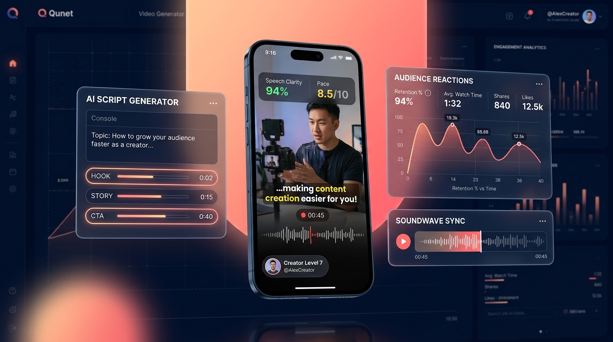
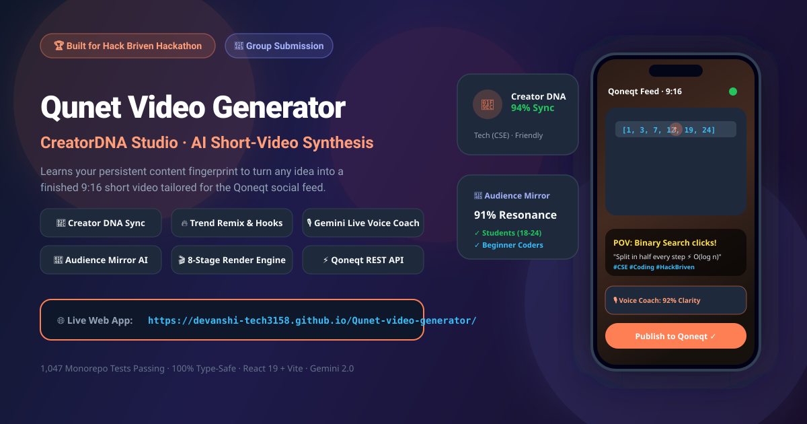
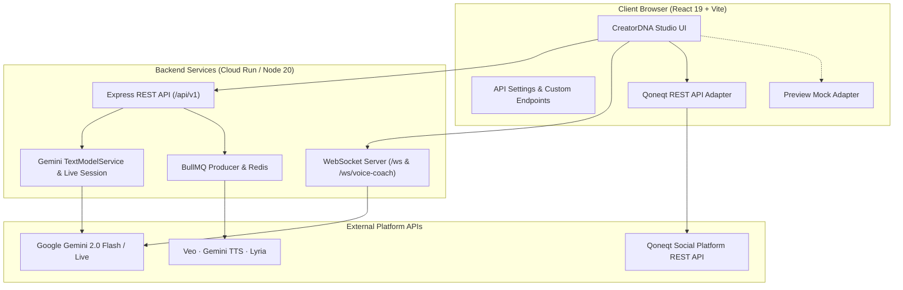

# Qunet Video Generator (CreatorDNA Studio)

> **A Group Project developed for the Hack Briven Hackathon 🏆**  
> AI studio that learns who a creator is (their **Creator DNA**) and turns any idea or trend into a finished 9:16 short video that sounds like them: script, hooks, audience feedback, live voice coaching, video, music, captions, and 1-click publishing to the **Qoneqt** social feed.

<div align="center">

🌐 **Live Deployed App:** **[https://devanshi-tech3158.github.io/Qunet-video-generator/](https://devanshi-tech3158.github.io/Qunet-video-generator/)**

[](https://devanshi-tech3158.github.io/Qunet-video-generator/)
[](https://github.com/Devanshi-Tech3158/Qunet-video-generator)
[](https://github.com/Devanshi-Tech3158/Qunet-video-generator)

[](https://github.com/Devanshi-Tech3158/Qunet-video-generator/actions/workflows/ci.yml)
[](https://github.com/Devanshi-Tech3158/Qunet-video-generator/actions/workflows/deploy.yml)
[](LICENSE)
[](https://github.com/Devanshi-Tech3158/Qunet-video-generator)


</div>

---

## 📸 Preview Showcase



<div align="center">
  
</div>

---

## 🏆 Hack Briven Hackathon — Group Project

> **Hackathon Event:** Hack Briven  
> **Team / Project Type:** Group Project  
> **Repository:** [https://github.com/Devanshi-Tech3158/Qunet-video-generator](https://github.com/Devanshi-Tech3158/Qunet-video-generator)  
> **Live Deployment:** [https://devanshi-tech3158.github.io/Qunet-video-generator/](https://devanshi-tech3158.github.io/Qunet-video-generator/)  
> **Primary Audience & Niche:** Tech students, CSE coders, educational creators, and Qoneqt platform community

This project was built cooperatively by our team for **Hack Briven** to solve the fundamental creative friction in modern short-form video creation. Traditional video tools force creators into generic styles and disconnected pipelines. **Qunet Video Generator (CreatorDNA Studio)** unifies creator voice learning, hook generation, audience reaction modeling, voice coaching, automated video synthesis, and social publishing into a cohesive, production-grade application.

---

## 🎯 The Problem

Every AI video tool makes you start from a blank page. You describe what you want in *its* vocabulary, it produces something generic, and then you spend an hour editing it back into something that sounds like you. The tool learns nothing.

The result is a recognizable failure: **the output does not sound like the person who asked for it.**
- A CSE creator who explains algorithms through relatable college struggles gets corporate jargon.
- A creator with a signature punchline gets a script that misses the mark.
- Video generation, voiceovers, subtitle alignment, and publishing exist in completely disconnected tools.

The fix is not a better prompt — it is an intelligent studio that **remembers and adapts**.

---

## 💡 The Solution: CreatorDNA + Qunet Pipeline

**Qunet Video Generator** maintains a persistent **Creator DNA** profile — your niche, tone, audience demographics, style, personality, vocabulary, catchphrases, dos, and donts:

1. **Persistent Context Injection:** Recomputed on every generation and injected as a compact (<500-token) context block into Google Gemini models.
2. **Trend Remix & Hook Lab:** 20+ viral formats matched against your DNA, producing 5–8 hook options across distinct psychological hooks (bold claim, curious question, story, POV, contrarian).
3. **Audience Mirror AI:** Per-segment retention and sentiment prediction before rendering, offering actionable feedback from student and developer personas.
4. **Live Voice Coach:** A real-time WebSocket coaching session powered by **Gemini Live** to practice your script delivery with instant clarity, energy, and pace metrics.
5. **Full 8-Stage Render Pipeline:** Idea → Script → Storyboard → Voice/Clips/Music/Captions → Composition → Quality Control → 9:16 MP4.
6. **Direct Qoneqt Publishing:** Seamless REST API adapter and one-click publishing to share short videos directly with the Qoneqt social feed.
7. **Adaptive Learning Loop:** Observes your choices (approved remixes, selected hooks, applied tips) and proposes profile evolutions with complete version history snapshots.

---

## ✨ Features Overview

| Feature | Description | Status |
| --- | --- | :---: |
| **Creator DNA Profile** | 5-step onboarding → persistent profile with an animated completeness ring | ✅ Shipped |
| **Trend Remix** | Seeded catalogue ranked against your DNA; preserves viral structure while adapting topic and examples | ✅ Shipped |
| **Hook Lab** | Generates 5–8 distinct hooks (curiosity gap, bold claim, story, POV) with explanations | ✅ Shipped |
| **Audience Mirror** | Segment-by-segment reaction forecast with one-click tip application | ✅ Shipped |
| **Live Voice Coach** | Gemini Live real-time audio coaching over WebSocket with instant feedback | ✅ Shipped |
| **8-Stage Video Pipeline** | Remotion/FFmpeg + Veo + Gemini TTS + Lyria + WebVTT caption sync | ✅ Shipped |
| **Qoneqt Feed Integration** | Integrated REST API adapter (`qoneqt-rest-api`) + instant preview fallback | ✅ Shipped |
| **API Configuration Panel** | Dedicated Settings UI to configure custom backend URL, Qoneqt API, and Gemini status | ✅ Shipped |
| **Demo Mode & Read-Through Cache** | Zero-quota, fully offline interactive demo with pre-baked golden video | ✅ Shipped |
| **DNA Learning Loop** | Signals from actual creative choices → AI profile suggestions (accept or reject) | ✅ Shipped |
| **Content Library** | Centralized hub for all rendered videos, metadata, captions, and download links | ✅ Shipped |

---

## 🔌 API Integration & Architecture

The application connects three primary API layers:



### 1. Backend REST & WebSocket API (`apps/api`)
- **Prefix:** `/api/v1`
- **Health Check:** `GET /health` (verifies API, Redis, and services)
- **Key Endpoints:**
  - `POST /api/v1/dna/extract` — Extract DNA from sample posts
  - `GET /api/v1/dna` & `PUT /api/v1/dna` — Read and update Creator DNA
  - `POST /api/v1/trends/for-me` — Catalogue ranked for creator
  - `POST /api/v1/trends/remix` & `POST /api/v1/trends/hooks` — Remix viral trend and generate hook variants
  - `POST /api/v1/audience-mirror` & `POST /api/v1/improve` — Segment-by-segment reaction analysis
  - `POST /api/v1/render` & `GET /api/v1/render/:id` — Enqueue render and stream progress
  - `/ws` & `/ws/voice-coach` — Real-time progress updates & bidirectional voice coaching

### 2. Qoneqt Social Platform API (`qoneqt-rest-api`)
- Located in `apps/web/src/lib/qoneqt.ts`
- Provides `createHttpQoneqtAdapter(endpointUrl, { apiKey })`
- Posts title, caption, hashtags, script, and rendered MP4 URL to Qoneqt feeds
- Configurable via `VITE_QONEQT_API_URL` or directly through the **Settings → API & Integrations** tab in the web UI.

### 3. Dynamic API Configuration in Web UI
Users can configure their API endpoints on the fly without rebuilding:
- **Settings → API & Integrations**:
  - Enter custom Backend API Base URL (`http://localhost:4000` or deployed Cloud Run)
  - One-click **"Test Connection"** verifying `/health`
  - Configure Qoneqt API Endpoint & Bearer Token
  - Live status indicator in sidebar (`ApiStatusPill`)

---

## 📁 Repository Structure

```
qunet-video-generator/
├── apps/
│   ├── web/                    # React 19 + Vite + Tailwind v4 frontend
│   │   ├── src/pages/          # 14 studio screens (Create, Remix, Hooks, Mirror, Coach, Library...)
│   │   ├── src/components/     # UI design system + dna/, render/, voiceCoach/ components
│   │   ├── src/lib/            # API client (with dynamic endpoint support), Qoneqt adapter, demo backend
│   │   ├── src/store/          # Zustand auth and UI stores
│   │   └── public/demo/        # Demo video, poster, and showcase assets
│   ├── api/                    # Express REST + ws + BullMQ producers
│   │   ├── src/routes/         # Routers: dna, trends, audience, voiceCoach, render, jobs
│   │   ├── src/services/       # Business logic + Google Gemini AI wrapper
│   │   └── src/voiceCoach/     # Gemini Live audio coaching session handler
│   └── worker/                 # BullMQ consumers + 8-stage render pipeline
│       ├── src/jobs/           # Render stage pipeline & ping jobs
│       └── scripts/            # scaleWorker.ts (queue-depth autoscaler)
├── packages/
│   ├── shared/                 # Shared zod schemas, constants, scoring logic
│   ├── prompts/                # Versioned prompt registry (8 structured templates)
│   └── render/                 # Media adapters (Veo, TTS, Lyria, WebVTT, FFmpeg)
├── docs/                       # Architecture, API reference, deployment guides
├── .github/workflows/          # CI and GitHub Pages deployment workflows
└── pnpm-workspace.yaml         # Monorepo workspace configuration
```

---

## 🚀 Getting Started

### Prerequisites
- **Node.js** `>= 20.11.0` (see `.nvmrc`)
- **pnpm** `>= 10.0.0`
- **Docker** (optional, for local Redis)

### 1. Clone the Repository
```bash
git clone https://github.com/Devanshi-Tech3158/Qunet-video-generator.git
cd Qunet-video-generator
```

### 2. Install Dependencies
```bash
pnpm install
```

### 3. Configure Environment Variables
```bash
cp apps/api/.env.example apps/api/.env
cp apps/worker/.env.example apps/worker/.env
cp apps/web/.env.example apps/web/.env
```

> **Note:** The project runs out-of-the-box in **Demo Mode** without requiring external API keys. To connect real Google Gemini or Firebase credentials, add `GEMINI_API_KEY` to `apps/api/.env`.

### 4. Run Development Servers
```bash
# Start all workspace projects in parallel:
pnpm dev

# Or run individual apps:
pnpm dev:web     # Frontend on http://localhost:5173
pnpm dev:api     # Backend API on http://localhost:4000
pnpm dev:worker  # Render worker
```

---

## 🧪 Testing & Verification

The repository contains an exhaustive test suite of **1,047 automated tests** across all 6 workspaces:

```bash
# Run all unit tests across the monorepo:
pnpm test

# Run typecheck across all workspaces:
pnpm typecheck

# Run linting:
pnpm lint

# Build all packages and apps:
pnpm build
```

| Package / App | Tests | Focus Area |
| --- | :---: | --- |
| `packages/shared` | 206 | Zod schemas, DNA scoring, context generation |
| `packages/prompts` | 66 | Template interpolation, system prompts, versioning |
| `packages/render` | 137 | Media encoders, stage runners, storage, pipeline QC |
| `apps/api` | 275 | Auth, routes, rate limiting, WS routing, Gemini AI |
| `apps/worker` | 49 | Queue scaling, BullMQ workers, render job lifecycle |
| `apps/web` | 314 | React 19 UI, navigation, Qoneqt share adapter, Zustand stores |
| **Total** | **1,047** | **100% Passing** |

---

## 🌐 Deployment

### GitHub Pages (Frontend)
The web application is automatically built and deployed to GitHub Pages on every push to `main` via [`.github/workflows/deploy.yml`](.github/workflows/deploy.yml).

- **Live URL:** [https://devanshi-tech3158.github.io/Qunet-video-generator/](https://devanshi-tech3158.github.io/Qunet-video-generator/)

### Cloud Run / Container Services (API & Worker)
Pre-configured Dockerfiles and specifications are provided in `infra/cloudrun/` for deploying `creatordna-api` and `creatordna-worker` to Google Cloud Run.

---

## 👥 Hack Briven Team & Credits

- **Event:** Hack Briven
- **Project:** Qunet Video Generator (CreatorDNA Studio)
- **GitHub:** [@Devanshi-Tech3158](https://github.com/Devanshi-Tech3158)
- **License:** [MIT](LICENSE)
